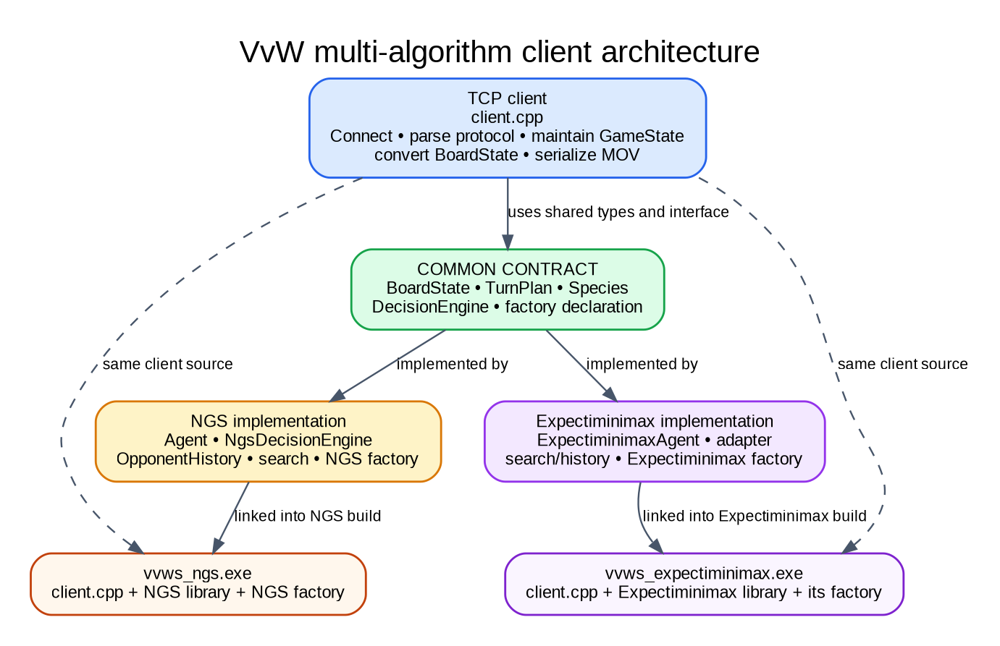
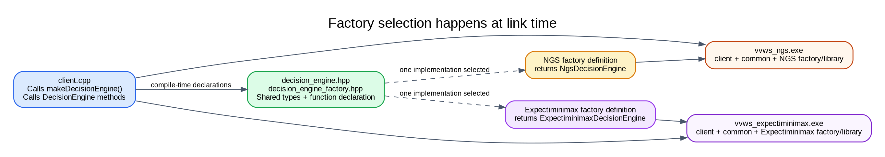
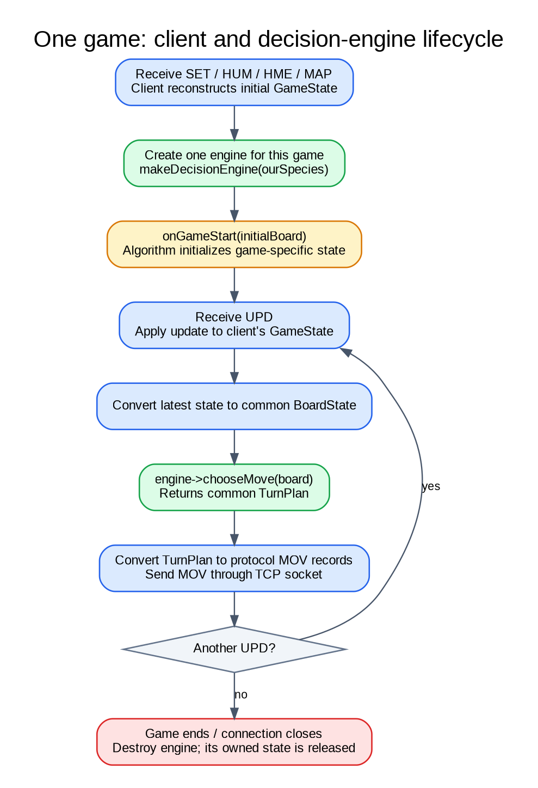

# Vampires vs Werewolves — Multi-Algorithm Client Architecture and Windows Build Guide

This README is the implementation and operations guide for the C++ game client. It documents the shared decision-engine abstraction, the existing NGS integration, how to add another algorithm such as Expectiminimax, and how to build, test, run, and distribute separate Windows executables.

> **Working directory:** Run CMake commands from `vvws_cpp_client/`. The `common/`, `ngs/`, `expectiminimax/`, and `vvws_cpp_client/` directories are siblings under the repository root.

> **Implementation status:** The NGS adapter and factory are implemented and the reported macOS build passed five tests. Expectiminimax and the two-executable CMake configuration are documented as work to add; do not assume they exist until their source files and targets have been created and tested.

## Contents

1. [Purpose and scope](#purpose-and-scope)
2. [Big picture: responsibilities and boundaries](#big-picture-responsibilities-and-boundaries)
3. [Repository layout and file responsibilities](#repository-layout-and-file-responsibilities)
4. [Shared game types](#shared-game-types-commonincludevvvagametypeshpp)
5. [The DecisionEngine abstraction](#the-abstraction-decisionengine)
6. [The factory](#the-factory-declaration-definition-and-selection)
7. [NGS adapter and compatibility layer](#ngs-adapter-and-compatibility-layer)
8. [Client integration and game lifecycle](#client-integration-and-game-lifecycle)
9. [Add a second algorithm: Expectiminimax](#add-a-second-algorithm-expectiminimax-step-by-step)
10. [CMake: build two executables](#cmake-build-two-executables-from-the-same-client-source)
11. [Build and test on Windows x64](#build-and-test-on-windows-x64)
12. [Run a selected algorithm](#run-a-selected-algorithm-against-the-game-server)
13. [Package and distribute the Windows executables](#package-and-distribute-the-windows-executables)
14. [Troubleshooting](#troubleshooting)
15. [Development workflow and Git checkpoints](#development-workflow-and-git-checkpoints)
16. [Final acceptance checklist](#final-acceptance-checklist)
17. [Quick reference: Windows commands](#quick-reference-windows-commands)
18. [References](#references)


# Purpose and scope

This guide describes the current C++ client architecture and gives a complete procedure for extending it with another decision algorithm without rewriting the TCP client. It then explains how to configure, compile, test, run and package separate Windows executables for each algorithm.

The intended result is:

- `vvws_ngs.exe` - the shared TCP client linked to the NGS implementation.
- `vvws_expectiminimax.exe` - the same TCP client source linked to the Expectiminimax implementation.

The client source is shared. The algorithm implementation and the factory definition linked into each executable are different.

## Status: what exists and what is planned

The following points reflect the project state established in the working session:

| Component | Status | Notes |
|---|---|---|
| `common/include/vvw/game/types.hpp` | Implemented | Shared game types are defined in `vvw::game`. |
| `common/include/vvw/game/decision_engine.hpp` | Implemented | Defines the algorithm interface. |
| `common/include/vvw/game/decision_engine_factory.hpp` | Implemented | Declares the common factory function. |
| `ngs/src/types.hpp` | Implemented | Compatibility aliases preserve the `vvw::ngs` names. |
| `ngs/src/ngs_decision_engine.hpp/.cpp` | Implemented | Adapts the existing NGS `Agent` to the shared interface. |
| `ngs/src/decision_engine_factory.cpp` | Implemented | Creates and returns an `NgsDecisionEngine`. |
| `vvws_cpp_client/client.cpp` | Uses the common factory/interface | The client calls `makeDecisionEngine()`, `onGameStart()` and `chooseMove()`. Verify that no other NGS-specific includes or calls remain before declaring the client fully algorithm-independent. |
| CMake NGS library and current client | Implemented | The current configuration builds `vvws_ngs` and one executable named `vvws_client`. |
| Separate Expectiminimax library/factory/adapter | To add | The instructions below define where and how to add it. |
| Two separately named executables | To configure | The current single `vvws_client` target must be replaced by two client targets. |

The macOS build and test run reported during the working session completed successfully: all five registered tests passed. That is evidence for the current macOS build, not a claim that the Windows build has already been run. Follow the Windows verification steps in this document on the target Windows toolchain.

# Big picture: responsibilities and boundaries

The project follows one rule:

> The TCP client owns communication and protocol handling. A decision engine owns strategy. The common interface connects the two without making the client depend on a particular strategy.

## Responsibility of the TCP client

The client is responsible for:

1. Opening a TCP connection to the professor's game server.
2. Receiving and parsing protocol messages such as `SET`, `HUM`, `HME`, `MAP` and `UPD`.
3. Maintaining the latest reconstructed game state in its client-side state object.
4. Converting that state to the shared `vvw::game::BoardState` representation.
5. Creating the selected decision engine through `makeDecisionEngine()`.
6. Calling the shared decision-engine methods.
7. Converting the returned `TurnPlan` into the server's `MOV` records.
8. Sending the `MOV` response through the existing socket code.

The client must not know how NGS generates candidates, how Expectiminimax searches a tree, or how either strategy stores its private history.

## Responsibility of an algorithm

Each algorithm is responsible for:

- interpreting the supplied common `BoardState`;
- initializing its own game-specific state;
- maintaining its own strategy-specific history or caches, if required;
- choosing a complete `TurnPlan` for the current update;
- returning that plan using the common type.

NGS-specific components such as `OpponentHistory`, candidate generation, candidate ranking and opponent search remain inside `ngs/`. Expectiminimax-specific search, chance-node handling and any Expectiminimax history remain inside `expectiminimax/`.

## Architecture diagram



The two algorithm libraries both implement the common contract. Each executable links the same `client.cpp` with exactly one algorithm library and its factory implementation.

# Repository layout and file responsibilities

The important directory relationship is that `common/`, `ngs/`, `expectiminimax/` and `vvws_cpp_client/` are siblings under the repository root. The CMake project is inside `vvws_cpp_client/` and refers to the other modules using relative paths such as `../common/` and `../ngs/`.

```text
VampiresvsWerewolvesAI/
|
|-- common/
|   |-- include/
|   |   `-- vvw/
|   |       |-- game/
|   |       |   |-- types.hpp
|   |       |   |-- decision_engine.hpp
|   |       |   `-- decision_engine_factory.hpp
|   |       `-- tests/
|   |           `-- decision_engine_test.cpp
|   |
|-- ngs/
|   |-- src/
|   |   |-- types.hpp                       # Compatibility aliases
|   |   |-- agent.hpp / agent.cpp           # NGS orchestration
|   |   |-- ngs_decision_engine.hpp/.cpp    # Common-interface adapter
|   |   |-- decision_engine_factory.cpp     # NGS factory definition
|   |   |-- opponent_history.hpp/.cpp
|   |   |-- candidate_generator.hpp/.cpp
|   |   |-- candidate_ranker.hpp/.cpp
|   |   |-- evaluation.hpp/.cpp
|   |   |-- movement_rules.hpp/.cpp
|   |   |-- transition_engine.hpp/.cpp
|   |   |-- opponent_predictor.hpp/.cpp
|   |   |-- opponent_search.hpp/.cpp
|   |   `-- other NGS implementation files
|   `-- tests/
|       |-- agent_test.cpp
|       |-- opponent_history_test.cpp
|       `-- ngs_decision_engine_test.cpp
|
|-- expectiminimax/                         # Add for the second algorithm
|   |-- src/
|   |   |-- expectiminimax_agent.hpp/.cpp
|   |   |-- expectiminimax_decision_engine.hpp/.cpp
|   |   `-- decision_engine_factory.cpp
|   `-- tests/
|       |-- expectiminimax_agent_test.cpp
|       `-- expectiminimax_decision_engine_test.cpp
|
`-- vvws_cpp_client/
    |-- client.cpp                          # Shared TCP/protocol client
    |-- CMakeLists.txt                       # Builds libraries and executables
    |-- tests/
    |   `-- mock_server_test.cpp
    `-- build/                               # Generated; do not commit
        `-- windows-x64/
            |-- vvws_ngs.exe
            `-- vvws_expectiminimax.exe
```

**Keep the sibling-directory relationship.** If the folders are moved independently, update the CMake relative paths accordingly. Run all CMake commands from `vvws_cpp_client/`, not from the repository root.

The current common contract test is located at `common/include/vvw/tests/decision_engine_test.cpp`. Although tests are often kept in a separate `tests/` directory, this guide preserves the project's existing location. Its CMake path must match the actual location; do not move it just to follow a convention.

# Shared game types: `common/include/vvw/game/types.hpp`

This file is the single source of truth for the game representation shared by the client and all algorithms. Define each shared type once here. Do not create a second copy of `BoardState`, `Species`, `Move` or `TurnPlan` inside Expectiminimax.

The current shared types include:

| Type | Meaning |
|---|---|
| `Population` | Unsigned population count (`std::uint32_t`). |
| `Position` | Grid coordinates `x` and `y`. |
| `Species` | `Unknown`, `Vampires` or `Werewolves`. |
| `Cell` | Humans, vampires, werewolves and the `isHouse` flag for one cell. |
| `Move` | Source position, population count and destination position. |
| `TurnPlan` | Vector of moves returned for one turn. |
| `PlyFootprint` | Whether the previous ply is known and its source/destination positions. |
| `GameHorizon` | Plies used/remaining and elapsed game time/remaining time. |
| `BoardState` | Dimensions, cells, our species, previous-ply footprint and game horizon. |

`BoardState` also provides helpers such as `inBounds()`, `index()`, `at()` and `hasValidStorage()`. Algorithms should use these shared semantics rather than inventing a second board layout.

The declarations live in:

```cpp
namespace vvw::game {
    // Population, Position, Species, Cell, Move, TurnPlan,
    // PlyFootprint, GameHorizon and BoardState
}
```

The file should include the standard headers required by its public declarations, including `<algorithm>`, `<cstddef>`, `<cstdint>`, `<stdexcept>` and `<vector>`. The namespace-closing comment should read `// namespace vvw::game`.

## Why common types matter

The client constructs a `vvw::game::BoardState`. The selected algorithm receives that exact type. The algorithm returns a `vvw::game::TurnPlan`. The client serializes that plan.

There is no NGS-to-Expectiminimax board conversion in the client. If an algorithm uses a different internal representation, convert between that representation and `vvw::game` types inside that algorithm's adapter.

# The abstraction: `DecisionEngine`

File: `common/include/vvw/game/decision_engine.hpp`

```cpp
#pragma once

#include "vvw/game/types.hpp"

namespace vvw::game {

class DecisionEngine {
public:
    virtual ~DecisionEngine() = default;

    // Called once after SET/HUM/HME/MAP for each game.
    virtual bool onGameStart(const BoardState& initialBoard) {
        (void)initialBoard;
        return true;
    }

    // Called for every UPD. Returns a complete turn plan.
    virtual TurnPlan chooseMove(const BoardState& board) = 0;
};

} // namespace vvw::game
```

## What this class is

`DecisionEngine` is an abstract interface, not an AI algorithm. It defines the operations that a concrete algorithm exposes to the client.

### Virtual destructor

```cpp
virtual ~DecisionEngine() = default;
```

The client owns the selected object through a `std::unique_ptr<DecisionEngine>`. The actual object may be an `NgsDecisionEngine` or an `ExpectiminimaxDecisionEngine`. The virtual destructor ensures that destruction through the base-class pointer correctly runs the derived destructor.

### `onGameStart()`

```cpp
virtual bool onGameStart(const BoardState& initialBoard) {
    (void)initialBoard;
    return true;
}
```

The client calls this once after it has reconstructed the initial board from the setup messages. The default implementation does nothing and returns success. An algorithm that needs initialization can override it.

For NGS, this is where the initial state is passed into its history/orchestration logic. Expectiminimax may initialize caches, search state or history here. An algorithm with no special setup can use the default implementation.

The Boolean return value allows the algorithm to reject an invalid initial state or report initialization failure. The client must check the return value rather than silently continuing.

### `chooseMove()`

```cpp
virtual TurnPlan chooseMove(const BoardState& board) = 0;
```

The `= 0` makes this a pure virtual function. Every concrete decision engine must implement it. It receives the latest board snapshot and returns the complete plan for that turn.

The client does not receive `AgentDecision`, candidate counts, search diagnostics or algorithm-specific history status. Those remain private to the algorithm. If the client later needs generic diagnostics, add a deliberately designed common result type rather than leaking NGS-only types into the client.

## Runtime polymorphism

A `std::unique_ptr<DecisionEngine>` can own an object of a derived class. Calling `engine->chooseMove(board)` invokes the override belonging to the actual object. This is C++ runtime polymorphism (virtual dispatch).

The client therefore uses the same code regardless of which concrete algorithm is linked into the executable.

# The factory: declaration, definition and selection

There are two factory-related files, and they have different jobs.

## Factory declaration

File: `common/include/vvw/game/decision_engine_factory.hpp`

```cpp
#pragma once

#include "vvw/game/decision_engine.hpp"

#include <memory>

namespace vvw::game {

std::unique_ptr<DecisionEngine> makeDecisionEngine(Species ourSpecies);

} // namespace vvw::game
```

This header declares a function. It does not create an object and it does not decide which algorithm to use. It tells the client that an implementation of `makeDecisionEngine()` will be provided when the executable is linked.

`std::unique_ptr` expresses exclusive ownership. The client owns the returned engine, and the engine is destroyed automatically when the pointer goes out of scope or is reset.

The argument `ourSpecies` is the side the program controls (Vampires or Werewolves). It is **not** the algorithm selector. The algorithm is selected by which factory implementation is linked into the executable.

## NGS factory definition

File: `ngs/src/decision_engine_factory.cpp`

```cpp
#include "ngs_decision_engine.hpp"
#include "vvw/game/decision_engine_factory.hpp"

#include <memory>

namespace vvw::game {

std::unique_ptr<DecisionEngine> makeDecisionEngine(
    Species ourSpecies
) {
    if (ourSpecies == Species::Unknown) {
        return nullptr;
    }

    return std::make_unique<vvw::ngs::NgsDecisionEngine>(ourSpecies);
}

} // namespace vvw::game
```

This source file knows about `NgsDecisionEngine`, constructs it and returns it as a pointer to the base interface. That conversion is an upcast from the derived class to `DecisionEngine`.

The factory definition is compiled into the NGS library. The client can call the common function without including `ngs_decision_engine.hpp`.

## Why there is one factory definition per executable

The NGS and Expectiminimax factory definitions deliberately have the same function name and signature:

```cpp
std::unique_ptr<vvw::game::DecisionEngine>
vvw::game::makeDecisionEngine(vvw::game::Species);
```

The NGS definition returns an `NgsDecisionEngine`; the Expectiminimax definition returns an `ExpectiminimaxDecisionEngine`.

A single executable must link exactly one definition. Linking both factory source files into one executable would create a duplicate-symbol/ multiple-definition linker error. Separate executables avoid that conflict.



# NGS adapter and compatibility layer

NGS already has its own types and its own `Agent` API. The adapter lets the existing implementation satisfy the common contract without making the client understand NGS internals.

## Compatibility header

File: `ngs/src/types.hpp`

Keep this file. It should contain aliases, not duplicate definitions:

```cpp
#pragma once

#include "vvw/game/types.hpp"

namespace vvw::ngs {

using vvw::game::Population;
using vvw::game::Position;
using vvw::game::Species;
using vvw::game::Cell;
using vvw::game::Move;
using vvw::game::TurnPlan;
using vvw::game::PlyFootprint;
using vvw::game::GameHorizon;
using vvw::game::BoardState;
using vvw::game::opponentOf;

} // namespace vvw::ngs
```

A `using` declaration does not create a second type. `vvw::ngs::BoardState` is another name for `vvw::game::BoardState`. Existing NGS files that refer to the old namespace can continue compiling while the definitions have one shared home.

New algorithms should use `vvw::game` types directly. Do not add Expectiminimax aliases to `vvw::ngs`.

## NGS adapter header

File: `ngs/src/ngs_decision_engine.hpp`

```cpp
#pragma once

#include "agent.hpp"
#include "vvw/game/decision_engine.hpp"

namespace vvw::ngs {

class NgsDecisionEngine final : public vvw::game::DecisionEngine {
public:
    explicit NgsDecisionEngine(vvw::game::Species ourSpecies);

    bool onGameStart(
        const vvw::game::BoardState& initialBoard
    ) override;

    vvw::game::TurnPlan chooseMove(
        const vvw::game::BoardState& board
    ) override;

private:
    Agent agent_;
};

} // namespace vvw::ngs
```

The adapter owns one `Agent` instance. Keeping the agent as a member means its internal state survives across calls to `chooseMove()` during the game.

## NGS adapter implementation

File: `ngs/src/ngs_decision_engine.cpp`

```cpp
#include "ngs_decision_engine.hpp"

namespace vvw::ngs {

NgsDecisionEngine::NgsDecisionEngine(
    vvw::game::Species ourSpecies
)
    : agent_(ourSpecies) {
}

bool NgsDecisionEngine::onGameStart(
    const vvw::game::BoardState& initialBoard
) {
    return agent_.observeInitialState(initialBoard);
}

vvw::game::TurnPlan NgsDecisionEngine::chooseMove(
    const vvw::game::BoardState& board
) {
    const AgentDecision decision = agent_.chooseMove(board);
    return decision.plan;
}

} // namespace vvw::ngs
```

The adapter translates the common API to the actual NGS API:

- the constructor creates the NGS `Agent` for our species;
- `onGameStart()` delegates to `observeInitialState()`;
- `chooseMove()` delegates to the NGS `Agent` and extracts `decision.plan`;
- the NGS-only `AgentDecision` remains inside the NGS module.

# Client integration and game lifecycle

The client includes the common headers:

```cpp
#include "vvw/game/decision_engine.hpp"
#include "vvw/game/decision_engine_factory.hpp"
```

It should not include NGS or Expectiminimax implementation headers.

## Create one engine per game

After the client has received the initial setup and reconstructed its state, it converts the controlled species and creates the engine:

```cpp
std::unique_ptr<vvw::game::DecisionEngine> engine =
    vvw::game::makeDecisionEngine(toGameSpecies(state.ourSpecies()));

if (!engine) {
    throw std::runtime_error("Decision-engine factory returned null");
}

const vvw::game::BoardState initialBoard = toGameBoardState(state);
if (!engine->onGameStart(initialBoard)) {
    throw std::runtime_error(
        "Selected decision engine rejected the initial board");
}
```

The exact helper names above should match the actual client implementation. The important contract is that the client converts its persistent protocol/game state into the common `BoardState`, creates one engine and checks initialization.

## Process each update

For each subsequent `UPD` message, the client should:

1. apply the update to its persistent client-side game state;
2. create a current `BoardState` snapshot;
3. call `engine->chooseMove(board)`;
4. validate/convert the returned common plan to the protocol move representation;
5. serialize and send the `MOV` message using the existing client code.

Conceptually:

```cpp
// The same engine instance remains alive throughout this game.
state.apply(message);

const vvw::game::BoardState board = toGameBoardState(state);
const vvw::game::TurnPlan plan = engine->chooseMove(board);

const auto protocolMoves = toProtocolMoves(plan);
socket.send(serializeMov(protocolMoves));
```

These are illustrative helper names. Retain the project's actual parser, state-update, serialization and socket function names.



## Lifecycle and history rules

- Create the engine once per game, not once per `UPD`.
- Call `onGameStart()` once after the initial board is reconstructed.
- Call `chooseMove()` for each update that requires a move.
- Keep the same engine object alive so algorithm-owned history/caches persist.
- Destroy or reset the engine when the game ends or the connection's game session ends.
- The client owns the latest board state. Algorithm-specific history remains inside the algorithm.

Do not move NGS's `OpponentHistory` into `common` just because another algorithm might someday need history. If Expectiminimax needs history, implement it in Expectiminimax. Introduce a shared generic history component only if multiple algorithms genuinely need the same representation and semantics.

Also do not infer an opponent's exact previous move footprint from sparse update messages unless the protocol actually provides enough information. The shared `PlyFootprint` should represent only information that the client/algorithm can reliably establish.

# Add a second algorithm: Expectiminimax, step by step

This section is the implementation recipe for a new algorithm. The same process can be reused for a third or fourth algorithm.

## Step 1 - Create the algorithm directory

At the repository root, create:

```text
expectiminimax/
|-- src/
`-- tests/
```

Do not place Expectiminimax implementation files inside `common/` or `ngs/`.

## Step 2 - Implement the algorithm independently

Create:

```text
expectiminimax/src/
|-- expectiminimax_agent.hpp
`-- expectiminimax_agent.cpp
```

The agent contains the actual Expectiminimax strategy: candidate/action generation, search tree, chance/opponent modelling, evaluation, pruning or other algorithm-specific logic.

Its public API should make it possible for the adapter to initialize it and request a plan. A convenient interface is:

```cpp
#pragma once

#include "vvw/game/types.hpp"

namespace vvw::expectiminimax {

class ExpectiminimaxAgent {
public:
    explicit ExpectiminimaxAgent(vvw::game::Species ourSpecies);

    bool observeInitialState(
        const vvw::game::BoardState& initialBoard
    );

    vvw::game::TurnPlan chooseMove(
        const vvw::game::BoardState& board
    );

private:
    vvw::game::Species ourSpecies_;
    // Add Expectiminimax-specific search state, history and configuration.
};

} // namespace vvw::expectiminimax
```

This is a recommended adapter-friendly API, not a requirement that the search internals use these exact names. If the existing Expectiminimax algorithm returns another result type, keep that internal result and translate it in the adapter. Do not force algorithm-specific concepts into `common` merely to make the signatures look identical.

## Step 3 - Create the adapter header

Create `expectiminimax/src/expectiminimax_decision_engine.hpp`:

```cpp
#pragma once

#include "expectiminimax_agent.hpp"
#include "vvw/game/decision_engine.hpp"

namespace vvw::expectiminimax {

class ExpectiminimaxDecisionEngine final
    : public vvw::game::DecisionEngine {
public:
    explicit ExpectiminimaxDecisionEngine(
        vvw::game::Species ourSpecies
    );

    bool onGameStart(
        const vvw::game::BoardState& initialBoard
    ) override;

    vvw::game::TurnPlan chooseMove(
        const vvw::game::BoardState& board
    ) override;

private:
    ExpectiminimaxAgent agent_;
};

} // namespace vvw::expectiminimax
```

The adapter inherits from `vvw::game::DecisionEngine`, exactly as the NGS adapter does. It owns one `ExpectiminimaxAgent` member so that the search state can persist across turns.

## Step 4 - Implement the adapter

Create `expectiminimax/src/expectiminimax_decision_engine.cpp`:

```cpp
#include "expectiminimax_decision_engine.hpp"

namespace vvw::expectiminimax {

ExpectiminimaxDecisionEngine::ExpectiminimaxDecisionEngine(
    vvw::game::Species ourSpecies
)
    : agent_(ourSpecies) {
}

bool ExpectiminimaxDecisionEngine::onGameStart(
    const vvw::game::BoardState& initialBoard
) {
    return agent_.observeInitialState(initialBoard);
}

vvw::game::TurnPlan ExpectiminimaxDecisionEngine::chooseMove(
    const vvw::game::BoardState& board
) {
    return agent_.chooseMove(board);
}

} // namespace vvw::expectiminimax
```

This exact example assumes the recommended agent API from Step 2. If the algorithm has a different API, change only the adapter translation. For example, if an internal method returns an `ExpectiminimaxDecision` with a `.bestPlan` field, the adapter can return `decision.bestPlan`.

## Step 5 - Implement the Expectiminimax factory

Create `expectiminimax/src/decision_engine_factory.cpp`:

```cpp
#include "expectiminimax_decision_engine.hpp"
#include "vvw/game/decision_engine_factory.hpp"

#include <memory>

namespace vvw::game {

std::unique_ptr<DecisionEngine> makeDecisionEngine(
    Species ourSpecies
) {
    if (ourSpecies == Species::Unknown) {
        return nullptr;
    }

    return std::make_unique<
        vvw::expectiminimax::ExpectiminimaxDecisionEngine
    >(ourSpecies);
}

} // namespace vvw::game
```

This file intentionally defines the same common function as the NGS factory. That is safe because the Expectiminimax executable links this definition instead of the NGS definition.

## Step 6 - Add Expectiminimax to CMake as a separate library

In `vvws_cpp_client/CMakeLists.txt`, add an Expectiminimax static library after the NGS library definition. Do this only after all listed `.cpp` files exist.

```cmake
# -----------------------------------------------------------------------------
# Expectiminimax decision-engine library
# -----------------------------------------------------------------------------
add_library(vvws_expectiminimax STATIC
    ../expectiminimax/src/expectiminimax_agent.cpp
    ../expectiminimax/src/expectiminimax_decision_engine.cpp
    ../expectiminimax/src/decision_engine_factory.cpp
    # Add every other Expectiminimax implementation .cpp file here.
)

target_compile_features(vvws_expectiminimax PUBLIC cxx_std_17)
target_include_directories(vvws_expectiminimax PUBLIC
    "${VVW_COMMON_INCLUDE_DIR}"
    "${CMAKE_CURRENT_SOURCE_DIR}/../expectiminimax/src"
)
```

If the algorithm has several implementation files (for example, evaluation, state transitions, chance-node generation or search), add every required `.cpp` file to this library. Headers are included by source files and normally do not need to be listed for compilation.

Do not add `../ngs/src/decision_engine_factory.cpp` to this library. Do not link `vvws_ngs` into the Expectiminimax client unless there is a genuine shared dependency that has been separated from the algorithm-specific factory. In particular, do not link both factory implementations into one executable.

## Step 7 - Add the algorithm tests

Create tests under `expectiminimax/tests/`, for example:

```text
expectiminimax/tests/
|-- expectiminimax_agent_test.cpp
`-- expectiminimax_decision_engine_test.cpp
```

Test at least:

- legal/valid action generation;
- terminal-state handling;
- board dimensions and bounds;
- correct handling of Vampires and Werewolves;
- expected behaviour when no legal move exists;
- search/evaluation behaviour on small hand-constructed boards;
- initialization through `onGameStart()`;
- a valid `TurnPlan` returned through `DecisionEngine::chooseMove()`;
- deterministic behaviour where the algorithm is expected to be deterministic;
- search budget/runtime limits appropriate for the server's response deadline.

Link algorithm-specific tests to `vvws_expectiminimax`, not to `vvws_ngs`.

## Step 8 - Do not modify the shared client to add the algorithm

If the architecture is working correctly, adding Expectiminimax should not require adding `#include "expectiminimax_agent.hpp"` or `#include "ngs_decision_engine.hpp"` to `client.cpp`.

The client continues to call:

```cpp
auto engine = vvw::game::makeDecisionEngine(ourSpecies);
```

Which concrete class is returned is determined by the factory implementation linked into that executable.

# CMake: build two executables from the same client source

This section shows the required CMake target structure after both algorithm libraries exist.

## Keep the NGS library and its factory together

The current NGS library source list should include `ngs_decision_engine.cpp` and `decision_engine_factory.cpp`, in addition to the NGS algorithm sources:

```cmake
add_library(vvws_ngs STATIC
    ../ngs/src/agent.cpp
    ../ngs/src/ngs_decision_engine.cpp
    ../ngs/src/decision_engine_factory.cpp
    ../ngs/src/movement_rules.cpp
    ../ngs/src/transition_engine.cpp
    ../ngs/src/evaluation.cpp
    ../ngs/src/candidate_generator.cpp
    ../ngs/src/multi_move_candidate_generator.cpp
    ../ngs/src/candidate_ranker.cpp
    ../ngs/src/opponent_history.cpp
    ../ngs/src/opponent_predictor.cpp
    ../ngs/src/opponent_search.cpp
)

target_compile_features(vvws_ngs PUBLIC cxx_std_17)
target_include_directories(vvws_ngs PUBLIC
    "${VVW_COMMON_INCLUDE_DIR}"
    "${VVW_NGS_SOURCE_DIR}"
    "${VVW_NGS_INCLUDE_DIR}"
)
```

Retain any additional NGS implementation sources already required by the repository. Do not accidentally remove source files when editing this list.

## Define the two client executables

Replace the current single-target block:

```cmake
add_executable(vvws_client client.cpp)
target_link_libraries(vvws_client PRIVATE vvws_ngs)
```

with:

```cmake
# Same TCP/protocol client source, linked to NGS.
add_executable(vvws_client_ngs
    client.cpp
)
target_compile_features(vvws_client_ngs PRIVATE cxx_std_17)
target_link_libraries(vvws_client_ngs PRIVATE vvws_ngs)
set_target_properties(vvws_client_ngs PROPERTIES
    OUTPUT_NAME "vvws_ngs"
)

# Same TCP/protocol client source, linked to Expectiminimax.
add_executable(vvws_client_expectiminimax
    client.cpp
)
target_compile_features(vvws_client_expectiminimax PRIVATE cxx_std_17)
target_link_libraries(vvws_client_expectiminimax PRIVATE vvws_expectiminimax)
set_target_properties(vvws_client_expectiminimax PROPERTIES
    OUTPUT_NAME "vvws_expectiminimax"
)
```

There are two different names for each target:

| CMake target name | Output executable name |
|---|---|
| `vvws_client_ngs` | `vvws_ngs.exe` |
| `vvws_client_expectiminimax` | `vvws_expectiminimax.exe` |

The target name is used with `cmake --build --target`. The output name is the `.exe` file that gets run or distributed.

## Add Windows socket libraries to both clients

The client uses TCP sockets. On Windows, link both client targets to Winsock:

```cmake
if(WIN32)
    foreach(target IN ITEMS
        vvws_client_ngs
        vvws_client_expectiminimax
    )
        target_link_libraries(${target} PRIVATE ws2_32)
        target_compile_definitions(${target} PRIVATE
            WIN32_LEAN_AND_MEAN
            NOMINMAX
        )
    endforeach()
endif()
```

Do not link `ws2_32` to only one client. Both executables contain the same networking code.

## Apply warnings and MinGW runtime options to both

If the CMake project defines `vvw_enable_warnings(target)`, call it for both executables and both algorithm libraries:

```cmake
vvw_enable_warnings(vvws_ngs)
vvw_enable_warnings(vvws_expectiminimax)
vvw_enable_warnings(vvws_client_ngs)
vvw_enable_warnings(vvws_client_expectiminimax)
```

For a MinGW Windows build, apply the runtime link options to both client executables:

```cmake
if(MINGW)
    foreach(target IN ITEMS
        vvws_client_ngs
        vvws_client_expectiminimax
    )
        target_link_options(${target} PRIVATE
            -static
            -static-libgcc
            -static-libstdc++
        )
    endforeach()
endif()
```

These options help avoid requiring separate GNU C++ runtime DLLs on the destination computer. They do not mean that every Windows system DLL is included in the executable. Windows system libraries such as Winsock remain operating-system dependencies.

## Update the mock-server protocol tests

The existing mock-server test receives the client executable path as an argument. After introducing two executables, register one protocol test per executable:

```cmake
add_test(
    NAME cpp_client_protocol_ngs
    COMMAND vvws_cpp_mock_server_test $<TARGET_FILE:vvws_client_ngs>
)

add_test(
    NAME cpp_client_protocol_expectiminimax
    COMMAND vvws_cpp_mock_server_test $<TARGET_FILE:vvws_client_expectiminimax>
)

set_tests_properties(
    cpp_client_protocol_ngs
    cpp_client_protocol_expectiminimax
    PROPERTIES TIMEOUT 30
)
```

This reuses the same mock-server test code to validate that both algorithm executables can perform the same protocol exchange. Keep the existing `vvws_cpp_mock_server_test` target and its Threads/Winsock dependencies.

Also update any other CMake references to the old `vvws_client` target, for example:

- `add_test(... $<TARGET_FILE:vvws_client>)`;
- MinGW link options applied only to `vvws_client`;
- scripts or IDE launch configurations that expect the old target name.

Once the two targets have been introduced, remove the old `vvws_client` target to avoid confusion about which executable is authoritative.

# Build and test on Windows x64

## Toolchain recommendation: MSYS2 UCRT64

The earlier Windows setup instructions used the MSYS2 `MINGW64` environment. **For a new setup in November 2026, use `UCRT64` instead.** MSYS2 announced the deprecation of MINGW64 on 15 March 2026 and reported in October 2026 that it had begun dropping MINGW64 package builds. The official MSYS2 documentation recommends UCRT64 or CLANG64 for new workflows.

This guide uses GCC in the UCRT64 environment. Do not mix UCRT64 libraries with libraries built in the old MINGW64 environment or with MSVC-built static libraries. Use one consistent compiler/runtime for all objects and static libraries in a build.

Official setup references:

- MSYS2: <https://www.msys2.org/>
- MSYS2 environments: <https://www.msys2.org/docs/environments/>
- MSYS2 with CMake: <https://www.msys2.org/docs/cmake/>
- MSYS2 news/deprecation update: <https://www.msys2.org/news/>

## Install MSYS2

1. Install 64-bit MSYS2 from <https://www.msys2.org/>.
2. Use the default installation path unless there is a reason to change it. The examples assume `C:\msys64`.
3. Open **MSYS2 MSYS** and update the package database/system:

```bash
pacman -Syu
```

4. If the terminal asks you to close it, close it, reopen MSYS2 and repeat the update command when requested.
5. Open **MSYS2 UCRT64** from the Start menu for all subsequent Windows x64 build commands.

## Install GCC, CMake and Ninja in UCRT64

Run this in the **MSYS2 UCRT64** terminal:

```bash
pacman -S --needed \
  mingw-w64-ucrt-x86_64-gcc \
  mingw-w64-ucrt-x86_64-cmake \
  mingw-w64-ucrt-x86_64-ninja
```

Ninja is the recommended default build tool in the current MSYS2 CMake documentation. CMake commands below use `-G Ninja` explicitly so the generator is predictable.

Verify the tools:

```bash
g++ --version
gcc --version
cmake --version
ninja --version
```

Each command should print a version. If `g++` or `cmake` is not found, check that the **UCRT64** terminal is open and that the UCRT64 packages installed successfully.

## Get the complete repository

Clone the repository or copy the complete `VampiresvsWerewolvesAI/` directory to the Windows computer. Do not copy only `vvws_cpp_client/`; the build needs sibling directories such as `common/` and `ngs/`.

At minimum, verify:

```bash
test -f CMakeLists.txt && echo "CMakeLists found"
test -f ../common/include/vvw/game/types.hpp && echo "Common types found"
test -f ../common/include/vvw/game/decision_engine.hpp && echo "DecisionEngine found"
test -f ../ngs/src/agent.hpp && echo "NGS agent found"
test -f ../ngs/src/decision_engine_factory.cpp && echo "NGS factory found"
```

For the two-algorithm build, also verify the Expectiminimax files exist:

```bash
test -f ../expectiminimax/src/expectiminimax_agent.cpp && echo "Expectiminimax agent found"
test -f ../expectiminimax/src/expectiminimax_decision_engine.cpp && echo "Expectiminimax adapter found"
test -f ../expectiminimax/src/decision_engine_factory.cpp && echo "Expectiminimax factory found"
```

The last three checks are expected to fail until the Expectiminimax implementation has been added.

## Change into the CMake project directory

Example if the repository is under `C:\Projects`:

```bash
cd /c/Projects/VampiresvsWerewolvesAI/vvws_cpp_client
```

Confirm the working directory:

```bash
pwd
```

It should end with:

```text
/VampiresvsWerewolvesAI/vvws_cpp_client
```

All CMake commands in this guide are run from this directory.

## Configure a Windows x64 Release build

Use a separate build directory for Windows. Do not reuse the macOS build directory.

```bash
cmake -S . -B build/windows-x64 \
  -G Ninja \
  -DCMAKE_BUILD_TYPE=Release \
  -DBUILD_TESTING=ON
```

Meaning of the options:

| Option | Meaning |
|---|---|
| `-S .` | Use the current `vvws_cpp_client/` directory as the source directory. |
| `-B build/windows-x64` | Put generated build files and binaries in a separate Windows build directory. |
| `-G Ninja` | Use the Ninja build generator. |
| `-DCMAKE_BUILD_TYPE=Release` | Build optimized Release binaries. |
| `-DBUILD_TESTING=ON` | Enable the project's CTest targets. |

CMake should finish with `Configuring done`, `Generating done` and a message showing the build directory.

If you previously configured `build/windows-x64` with another compiler, environment, generator or toolchain, delete that build directory and configure it again. CMake caches compiler and generator information:

```bash
rm -rf build/windows-x64
```

Do not delete the source directories. Only remove the generated build directory.

## Build both executables and all tests

Once both algorithm libraries and their CMake targets have been added:

```bash
cmake --build build/windows-x64 --parallel
```

This builds all targets enabled by the current CMake configuration, including both client executables and registered test executables.

The expected client binaries are:

```text
vvws_cpp_client/build/windows-x64/vvws_ngs.exe
vvws_cpp_client/build/windows-x64/vvws_expectiminimax.exe
```

Verify they exist:

```bash
ls -lh build/windows-x64/vvws_ngs.exe
ls -lh build/windows-x64/vvws_expectiminimax.exe
```

## Build only one algorithm executable

After configuration, a specific target can be built without building the other client target:

**NGS only:**

```bash
cmake --build build/windows-x64 --target vvws_client_ngs --parallel
```

Output file:

```text
build/windows-x64/vvws_ngs.exe
```

**Expectiminimax only:**

```bash
cmake --build build/windows-x64 --target vvws_client_expectiminimax --parallel
```

Output file:

```text
build/windows-x64/vvws_expectiminimax.exe
```

These are CMake target names. Use the `.exe` output names when running the client.

## Run the complete test suite

Build all targets first, then run:

```bash
ctest --test-dir build/windows-x64 --output-on-failure
```

To list the registered tests:

```bash
ctest --test-dir build/windows-x64 -N
```

The current five-test configuration includes:

| Test | Purpose |
|---|---|
| `decision_engine_contract_unit` | Tests the common interface/types contract without linking an algorithm. |
| `opponent_history_unit` | Tests NGS opponent-history behaviour. |
| `agent_orchestration_unit` | Tests NGS agent orchestration. |
| `ngs_decision_engine_unit` | Tests that NGS can be used through the common interface/factory. |
| `cpp_client_protocol` | Runs the client against the local mock server and checks the protocol exchange. |

After adding Expectiminimax, add its agent and adapter tests and replace the single protocol test with one protocol test per client executable. Therefore the future test count will be greater than five; use `ctest -N` to see the actual current list rather than relying on a fixed count.

A successful run ends with a summary similar to:

```text
100% tests passed, 0 tests failed
```

Do not package a build with failing tests. Keep the complete CTest output if a test fails.

**Important:** unit and mock-server tests do not prove that the client can complete a real game against the professor's server. They test local behaviour and protocol exchange. A separate real-server smoke test is still required.

# Run a selected algorithm against the game server

The executable accepts the server IP address and TCP port as command-line arguments. Substitute the actual values supplied for your game; this guide does not assume a particular port.

## Run NGS

From the MSYS2 UCRT64 terminal:

```bash
./build/windows-x64/vvws_ngs.exe SERVER_IP SERVER_PORT
```

From Windows PowerShell, while in `vvws_cpp_client/`:

```powershell
.\build\windows-x64\vvws_ngs.exe SERVER_IP SERVER_PORT
```

## Run Expectiminimax

From MSYS2 UCRT64:

```bash
./build/windows-x64/vvws_expectiminimax.exe SERVER_IP SERVER_PORT
```

From PowerShell:

```powershell
.\build\windows-x64\vvws_expectiminimax.exe SERVER_IP SERVER_PORT
```

Do not include angle brackets in the actual command. Replace `SERVER_IP` and `SERVER_PORT` with the supplied values.

If the professor's server and client are on the same Windows computer, `127.0.0.1` can be used as the IP only when the server is listening on the local loopback interface. For a server on another computer, use that computer's reachable IP address and ensure the relevant firewall/network rules allow the connection.

Start the professor-provided game server separately using its supplied configuration/instructions. The C++ client does not launch the server automatically.

# Package and distribute the Windows executables

## Recommended release folder

Keep CMake's generated build files under `build/`. Create a separate distribution folder containing only the binaries and any runtime assets that the program genuinely needs:

```text
VampiresvsWerewolvesAI/
|-- vvws_cpp_client/
|   `-- build/
|       `-- windows-x64/
|           |-- vvws_ngs.exe
|           `-- vvws_expectiminimax.exe
|
`-- dist/
    `-- windows-x64/
        |-- vvws_ngs.exe
        `-- vvws_expectiminimax.exe
```

From the UCRT64 terminal at the repository root:

```bash
mkdir -p dist/windows-x64
cp vvws_cpp_client/build/windows-x64/vvws_ngs.exe dist/windows-x64/
cp vvws_cpp_client/build/windows-x64/vvws_expectiminimax.exe dist/windows-x64/
ls -lh dist/windows-x64/
```

Alternatively, from PowerShell at the repository root:

```powershell
New-Item -ItemType Directory -Force dist\windows-x64
Copy-Item vvws_cpp_client\build\windows-x64\vvws_ngs.exe dist\windows-x64\
Copy-Item vvws_cpp_client\build\windows-x64\vvws_expectiminimax.exe dist\windows-x64\
Get-ChildItem dist\windows-x64
```

The final expected locations are:

```text
VampiresvsWerewolvesAI/dist/windows-x64/vvws_ngs.exe
VampiresvsWerewolvesAI/dist/windows-x64/vvws_expectiminimax.exe
```

## What must be transferred?

The static algorithm library is linked into its executable. The receiving computer does not need the algorithm `.cpp` files, `.hpp` files, CMake files, test executables or compiler just to launch the client.

However, do not assume that copying one `.exe` guarantees a self-contained deployment. The MinGW static runtime options reduce GNU C++ runtime DLL requirements, but Windows system DLLs remain dependencies. Inspect the binary and test it on a clean Windows computer that does not have the development toolchain installed.

If the program later reads configuration files, model weights, maps or other external data at runtime, package those files alongside the executable. The executable cannot load a source-tree file that was not included in the distribution.

## Deployment smoke test

On the destination computer:

1. Copy the selected executable(s) into a folder such as `C:\VVW\`.
2. Open PowerShell in that folder.
3. Run one executable with the real server IP and port.
4. Confirm that the client starts, connects and exchanges the expected protocol messages.
5. Repeat for the other executable.
6. Test both sides/factions if the competition setup requires the program to support both Vampires and Werewolves.

Example:

```powershell
cd C:\VVW
.\vvws_ngs.exe SERVER_IP SERVER_PORT
```

Then:

```powershell
.\vvws_expectiminimax.exe SERVER_IP SERVER_PORT
```

# Troubleshooting

| Symptom | Likely cause | What to check |
|---|---|---|
| CMake cannot find `../common/...` or `../ngs/...` | Wrong working directory or broken sibling-folder layout | Run CMake from `vvws_cpp_client/`; confirm `common/`, `ngs/` and `vvws_cpp_client/` are siblings. |
| CMake cannot find a newly listed `.cpp` file | The path was added to CMake before the file was created, or the path is wrong | Create the file at the exact path in the source list; verify with `ls`/`test -f`. |
| Undefined reference to `makeDecisionEngine(...)` | Factory declaration was included but the matching definition was not linked | Confirm the selected algorithm's `decision_engine_factory.cpp` is part of its library and that the client links that library. |
| Multiple definition of `makeDecisionEngine(...)` | Both algorithm factory implementations were linked into one executable | Link NGS factory only into `vvws_client_ngs`; link Expectiminimax factory only into `vvws_client_expectiminimax`. |
| `DecisionEngine` remains abstract | The derived adapter did not implement `chooseMove()` with the exact signature | Match the return type, parameter type and `const`/reference qualifiers; keep `override` on the declaration. |
| Cannot convert NGS types to common types | Duplicate type definitions remain in NGS | Replace duplicate definitions with aliases in `ngs/src/types.hpp`; ensure the NGS adapter uses `vvw::game` types. |
| Client includes an algorithm-specific header | The abstraction boundary has leaked | Keep concrete algorithm includes in the algorithm adapter and factory, not `client.cpp`. |
| Expectiminimax build fails on an NGS header | Expectiminimax accidentally depends on NGS | Use `vvw::game` common types and Expectiminimax-owned implementation types. |
| CMake reports compiler/generator mismatch | A build directory was configured with a different environment or generator | Delete only `build/windows-x64/` and configure again in UCRT64 with `-G Ninja`. |
| CTest says a test executable is missing | Tests were registered but their target was not built | Run `cmake --build build/windows-x64 --parallel` before CTest. |
| Mock protocol test fails for one executable | That executable may serialize differently, fail to start, or use a different protocol path | Run the failing test with verbose CTest output and compare the two client logs. |
| Client cannot connect to the professor's server | Wrong address/port, server not listening, routing/firewall issue | Verify the server is running, check the supplied address and port, and confirm Windows Firewall/network access. |
| EXE runs on build PC but not destination PC | Missing runtime DLL or external runtime asset | Test the exact copied executable on a clean x64 Windows PC; inspect DLL dependencies and package required data files. |

Useful diagnostic commands:

```bash
# Show CMake targets (run in the configured build directory)
cmake --build build/windows-x64 --target help

# List tests registered with CTest
ctest --test-dir build/windows-x64 -N

# Run tests with more detail
ctest --test-dir build/windows-x64 --output-on-failure -V

# Confirm the output files exist
ls -lh build/windows-x64/*.exe
```

# Development workflow and Git checkpoints

Use small changes that can be built and tested independently.

## When adding a new algorithm

1. Add the algorithm's agent and implementation files under its own directory.
2. Add the adapter header and implementation.
3. Add that algorithm's factory source.
4. Add the new static library to CMake.
5. Add the new executable target linked to that library.
6. Add algorithm-specific unit tests and an adapter test.
7. Add a mock-server protocol test using the new executable path.
8. Build and run the complete suite.
9. Run a real-server smoke test.
10. Commit the completed slice.

## Suggested commits

Keep architectural changes separate from strategy changes. For example:

```text
Introduce common decision-engine interface
Add NGS adapter and factory
Build NGS Windows client target
Add Expectiminimax agent and search
Add Expectiminimax decision-engine adapter and factory
Add separate Expectiminimax executable and protocol tests
```

Before committing:

```bash
git status --short
git diff --check
git diff --cached
```

Do not commit generated build directories or executable artifacts unless the project explicitly requires release binaries to be versioned. Normally add `build/` to `.gitignore` and distribute executables through the release/dist process.

# Final acceptance checklist

## Architecture

- [ ] Shared game type definitions exist only in `common/include/vvw/game/types.hpp`.
- [ ] `ngs/src/types.hpp` contains compatibility aliases only; it does not duplicate structures.
- [ ] `DecisionEngine` exposes `onGameStart()` and pure virtual `chooseMove()`.
- [ ] The NGS adapter delegates to the real NGS `Agent` API.
- [ ] The NGS factory creates `NgsDecisionEngine`.
- [ ] The Expectiminimax adapter implements the same shared interface.
- [ ] The Expectiminimax factory creates `ExpectiminimaxDecisionEngine`.
- [ ] Each executable links exactly one factory implementation.
- [ ] The client does not include or call algorithm-specific classes or methods.
- [ ] The same client source is compiled into both executables.
- [ ] The client creates one engine per game and preserves its lifetime across updates.
- [ ] Algorithm-specific history remains inside the corresponding algorithm unless a truly common abstraction is justified.

## Windows build and tests

- [ ] MSYS2 UCRT64 is installed and updated.
- [ ] UCRT64 GCC, CMake and Ninja are installed.
- [ ] The repository sibling-directory layout is preserved.
- [ ] CMake configures into `build/windows-x64/` using Ninja.
- [ ] Both executable targets compile successfully in Release mode.
- [ ] All registered common, algorithm and protocol tests pass.
- [ ] The mock-server test is run once against each executable.
- [ ] Both `.exe` files exist at their expected paths.
- [ ] Both clients have been smoke-tested against the professor's real server.
- [ ] The copied release binaries have been tested on the target Windows computer.

# Quick reference: Windows commands

Run these commands in **MSYS2 UCRT64**, from `vvws_cpp_client/`.

**Configure:**

```bash
cmake -S . -B build/windows-x64 \
  -G Ninja \
  -DCMAKE_BUILD_TYPE=Release \
  -DBUILD_TESTING=ON
```

**Build everything:**

```bash
cmake --build build/windows-x64 --parallel
```

**Build only NGS:**

```bash
cmake --build build/windows-x64 --target vvws_client_ngs --parallel
```

**Build only Expectiminimax:**

```bash
cmake --build build/windows-x64 --target vvws_client_expectiminimax --parallel
```

**Run all tests:**

```bash
ctest --test-dir build/windows-x64 --output-on-failure
```

**List tests:**

```bash
ctest --test-dir build/windows-x64 -N
```

**Run NGS:**

```bash
./build/windows-x64/vvws_ngs.exe SERVER_IP SERVER_PORT
```

**Run Expectiminimax:**

```bash
./build/windows-x64/vvws_expectiminimax.exe SERVER_IP SERVER_PORT
```

**Executable locations:**

```text
vvws_cpp_client/build/windows-x64/vvws_ngs.exe
vvws_cpp_client/build/windows-x64/vvws_expectiminimax.exe
```

**Recommended distribution locations:**

```text
dist/windows-x64/vvws_ngs.exe
dist/windows-x64/vvws_expectiminimax.exe
```

---

# References

The architecture and source-file names in this guide are based on the project structure and code supplied for this task. Windows setup commands were refreshed against the official MSYS2 documentation:

- MSYS2 environments: <https://www.msys2.org/docs/environments/>
- MSYS2 CMake guidance: <https://www.msys2.org/docs/cmake/>
- MSYS2 news and MINGW64 deprecation update: <https://www.msys2.org/news/>
